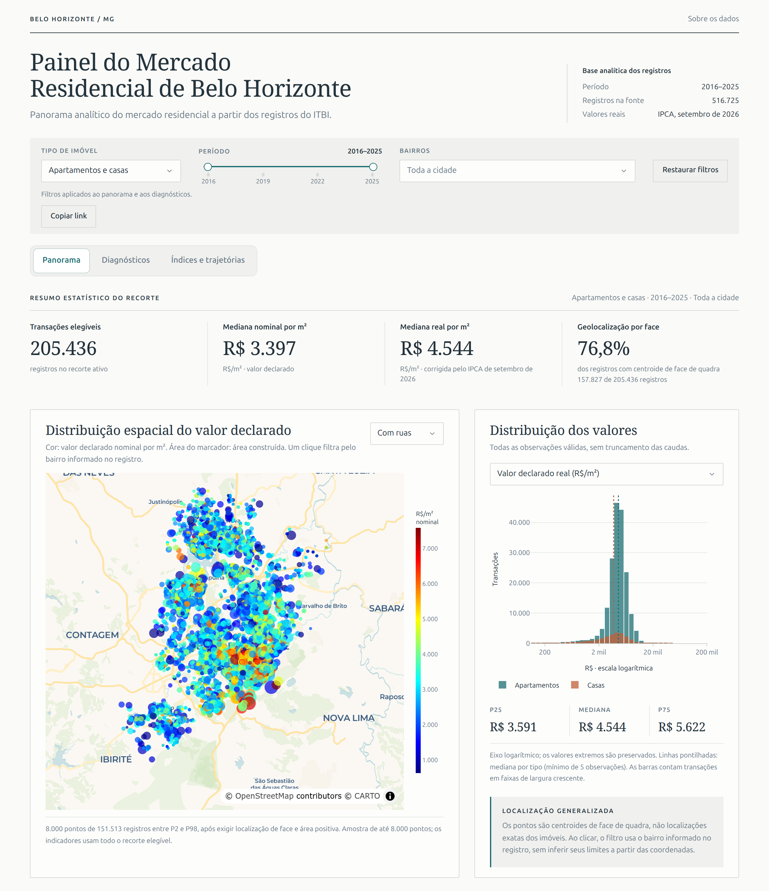
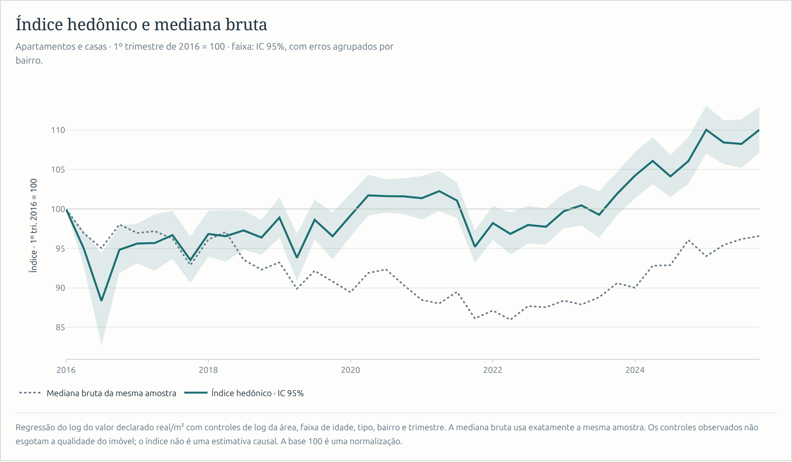
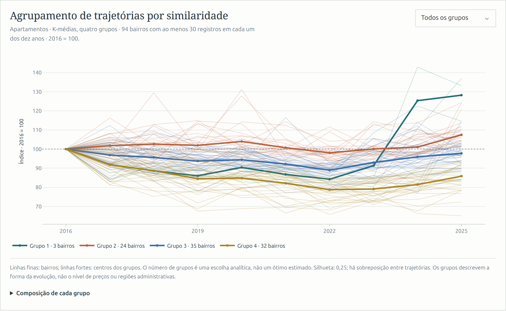

# Painel do Mercado Residencial de Belo Horizonte


Mapas, distribuições e índices para explorar o mercado residencial de Belo Horizonte entre 2016 e 2025, a partir dos registros de ITBI da Prefeitura de Belo Horizonte. Filtros interativos permitem definir recortes no panorama e nos diagnósticos e compartilhar a seleção por link.

**[Acessar o painel interativo](https://bh-itbi-dashboard.onrender.com/)**



*Panorama geográfico, indicadores e distribuição dos valores declarados de apartamentos e casas no recorte padrão.*



*Índice hedônico, média geométrica bruta e decomposição da diferença por característica observada na amostra de apartamentos e casas (1º tri. 2016 = 100).*



*Trajetórias das medianas anuais do valor real por m² de apartamentos, com base 100 em 2016 e os centros dos quatro grupos em destaque.*

## Executar localmente

Com o [uv](https://docs.astral.sh/uv/) instalado, na pasta do projeto:

```bash
uv sync --frozen
uv run python main.py prepare
uv run python main.py
```

Acesse [http://127.0.0.1:8050/](http://127.0.0.1:8050/) no navegador.

## Dados

Fonte: Prefeitura de Belo Horizonte, dados abertos (CC BY 4.0), tratados e disponibilizados em [pracadata/brazil-itbi](https://huggingface.co/datasets/pracadata/brazil-itbi). Projeto derivado e não oficial.

Os valores são declarados ao ITBI e não representam necessariamente preços de venda verificados.

Código disponibilizado sob a [licença MIT](LICENSE); os dados mantêm suas condições próprias de atribuição.
