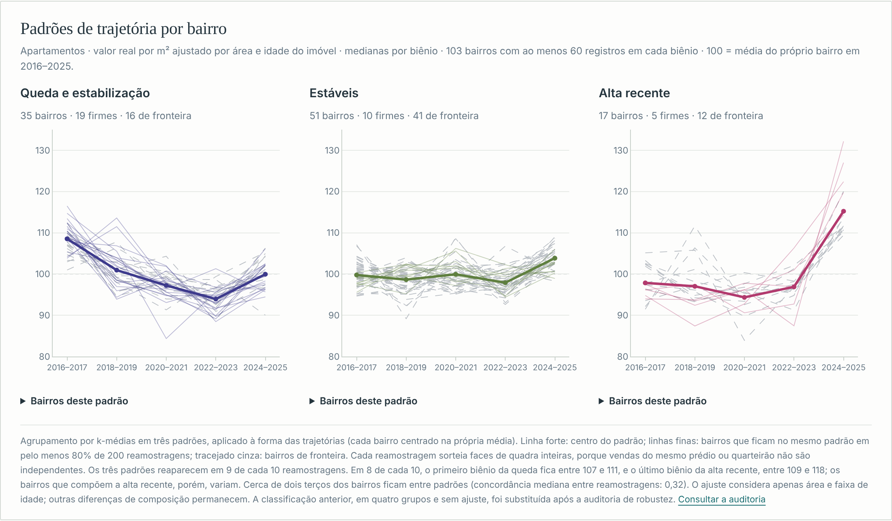

# Painel do Mercado Residencial de Belo Horizonte


Mapas, distribuições e índices para explorar o mercado residencial de Belo Horizonte entre 2016 e 2025, a partir dos registros de ITBI da Prefeitura de Belo Horizonte. Filtros interativos permitem definir recortes no panorama e nos diagnósticos e compartilhar a seleção por link.

**[Acessar o painel interativo](https://bh-itbi-dashboard.onrender.com/)**


*Panorama dos valores declarados de apartamentos e casas no recorte padrão, com mapa, distribuições, séries mensais e séries trimestrais por bairro.*


*Índice hedônico, média geométrica bruta e decomposição da diferença por característica observada na amostra de apartamentos e casas (1º tri. 2016 = 100).*

A aba de índices também apresenta três padrões de trajetória para apartamentos. As medianas por biênio usam valores reais por m² ajustados por área e faixa de idade, centrados na média de cada bairro. A frequência de permanência no mesmo padrão nas reamostragens distingue bairros firmes e de fronteira.



*Padrões de trajetória de apartamentos por biênio (100 = média do próprio bairro em 2016–2025), com firmeza avaliada por reamostragem de faces de quadra.*

## Executar localmente

Com o [uv](https://docs.astral.sh/uv/) instalado, na pasta do projeto:

```bash
uv sync --frozen
uv run python main.py prepare
uv run python main.py
```

Acesse [http://127.0.0.1:8050/](http://127.0.0.1:8050/) no navegador.

## Auditoria de robustez

A pasta [`docs/robustness`](docs/robustness/report.md) reúne uma auditoria reprodutível dos resultados analíticos (relatório em inglês): a reprodução do índice hedônico publicado, um protocolo de sensibilidade fixado antes da execução, estimadores robustos com inferência agrupada por bairro, a estabilidade dos padrões de trajetória e diagnósticos descritivos. A auditoria mostra quanto as estimativas dependem das escolhas de população e de estimador.

```bash
uv run python main.py prepare
uv run python main.py audit --output docs/robustness
```

## Dados

Os dados são provenientes dos registros oficiais de ITBI da Prefeitura de Belo Horizonte (CC BY 4.0), tratados e disponibilizados no conjunto de dados [pracadata/brazil-itbi](https://huggingface.co/datasets/pracadata/brazil-itbi), no Hugging Face.

O código do projeto é disponibilizado sob a licença MIT.
