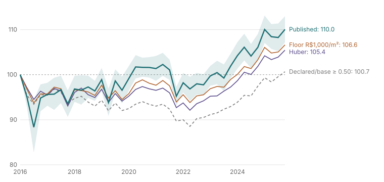

# How robust is the price index?

The published hedonic index puts the fourth quarter of 2025 at 110.0 (95% interval 107.2–113.0), with the first quarter of 2016 at 100. Re-estimated under 18 specifications, that figure ranges from 99.1 (declared/base ≥ 0.70) to 110.4 (apartments only). Most of the spread comes from one group of records: those declared far below the municipal tax base, concentrated in 2016–2019. Down-weighting outlying records with a Huber regression lowers the end of the series to 105.4, but does not remove the rise. The 2025 interval lies above 100 in 14 of the 18 specifications; the exceptions are the declared/base floors from 0.40 up.

*Quarterly index under four specifications (2016Q1 = 100). The shaded band is the 95% interval of the published index. The other specifications are in [index_trajectories.csv](index_trajectories.csv).*

## Where the spread comes from

**Very low declared values.** 4,996 records (2.4%) have a real declared value below R$1,000/m². Their median declared value is R$50,000, against R$339,800 for the rest, and 18% of the tax base; 40% are houses, against 10% of the other records. They are 4.4% of records in 2016 and 1.7% in 2025, so they pull the early quarters down and steepen the rise. The source cannot say what they are: it has no field for the nature of the transfer or the date of the contract. According to the municipal data dictionary, the published area already reflects the share acquired, so partial transfers would not explain them, provided the harmonised area column is the one the dictionary describes (still to be checked against the raw files). The Huber regression, which down-weights large residuals instead of dropping records, places 20% of the weight it removes on these records.

**No natural cut-off.** Raising a price floor from R$500/m² to R$1,500/m² lowers the 2025Q4 value step by step (109.1, 108.3, 106.6, 105.3, 104.5), with no level at which it settles. The Huber fit gives 105.4 (102.6–108.4); that is the figure the dashboard's sensitivity note reports.

**The tax base moved.** The median ratio of declared value to tax base rises from 0.91 in 2016 to 1.00 from 2021, and the share of records declared below the base falls from 69% to 24% in 2024, before rising again to 42% in 2025. Whatever the cause, the base is not a fixed yardstick across the period.

**Declared/base floors are therefore hard to read.** A floor of 0.50 removes 11.9% of 2016 records but 3.7% of 2025 records, mixing data quality with changes in how the base was set. These specifications give the lowest values (99.1–104.3) and are not a cleaner version of the index.

**Property type.** Apartments alone give 110.4; houses alone give 109.6 with a much wider interval (100.9–119.0), from 20,928 records. The common trend the pooled model imposes on both types is not what drives the result.

## Neighbourhood trajectory patterns

The dashboard groups 103 neighbourhoods into three patterns of quality-adjusted apartment prices by biennium: falling then stabilising (35), stable (51) and a late rise (17). Firmness comes from resampling whole block faces within each neighbourhood and biennium, because sales in the same building are not independent. The three patterns reappear in 93% of 200 draws, but membership is loose: 19, 10 and 5 neighbourhoods stay in their pattern in at least 80% of draws, and the median adjusted Rand index against the published partition is 0.32. Resampling individual records would give 0.60 and 72 firm members instead of 34, which overstates stability. Draws that miss the three patterns usually spend one centre on a single neighbourhood with an unusually wide spread of prices.

These patterns replace a four-group typology built on unadjusted annual medians, withdrawn when its bootstrap agreement came out at 0.45. The criterion for showing them (stable pattern shapes with membership reported per neighbourhood, rather than a stable partition) was settled after seeing these results.

## Other checks

- **Quarter-to-quarter noise.** Sampling error accounts for about 22% of the variance of quarterly changes in the published index, and consecutive changes are negatively correlated (−0.31), so single-quarter moves should not be over-read.
- **Round numbers.** 59% of declared values in the dashboard's range are exact multiples of R$10,000, which produces spikes in fine-grained histograms.
- **Neighbourhood quarterly medians.** Resampling by block face, the interval around a reference neighbourhood's quarterly median is typically 10% to 23% of the median itself.

## Limits

- The source does not identify market sales, so every specification is a proxy for the population of interest.
- The specifications share most of their records and their intervals are pointwise, so differences between them are descriptive rather than tests.
- The Huber intervals treat the estimated scales as fixed.
- Block faces approximate buildings; records without a matched face are resampled on their own.

## Files and reproduction

Running `python main.py audit` on the prepared cache regenerates every file here. This version comes from source revision `5908d77`, model `v5` and protocol `hedonic-sensitivity-v1`.

| File | Contents |
| --- | --- |
| [protocol.json](protocol.json) | the specifications and estimator settings |
| [specifications.csv](specifications.csv) | one row per specification: sample, fit and headline values |
| [index_trajectories.csv](index_trajectories.csv) | quarterly index and intervals for every specification |
| [decomposition.csv](decomposition.csv) | composition terms per specification and quarter |
| [exclusions.csv](exclusions.csv) | records removed by each screen, by year and property type |
| [huber_weights.csv](huber_weights.csv) | Huber scales and down-weighting by year and property type |
| [diagnostics.json](diagnostics.json) | price tails, low-tail profile, tax-base series, round numbers, quarterly noise, neighbourhood medians and the withdrawn typology |
| [trajectory_patterns.json](trajectory_patterns.json) | pattern centres, ranges and membership per neighbourhood |
| [manifest.json](manifest.json) | hashes, Git commit and software versions |
| [index_comparison.svg](index_comparison.svg) | the figure above |
